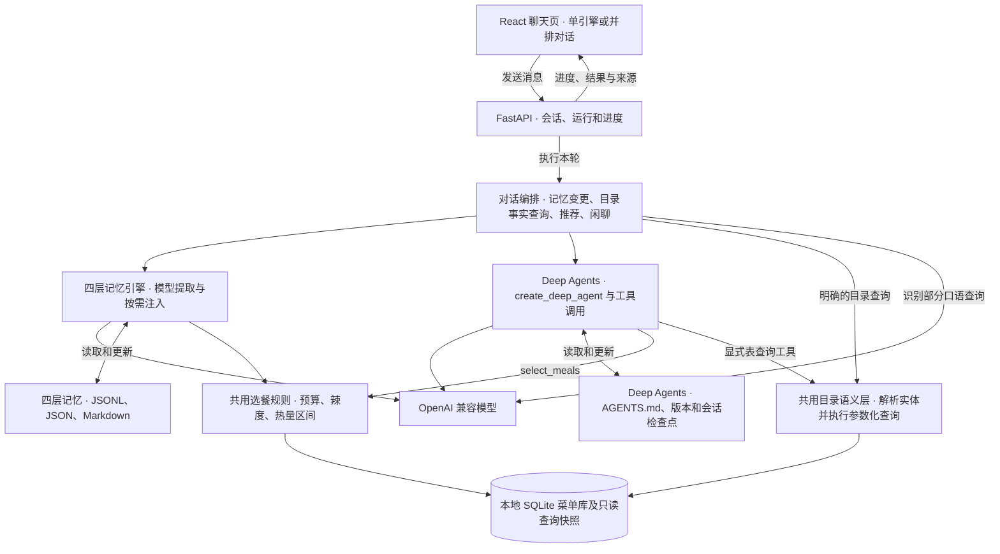
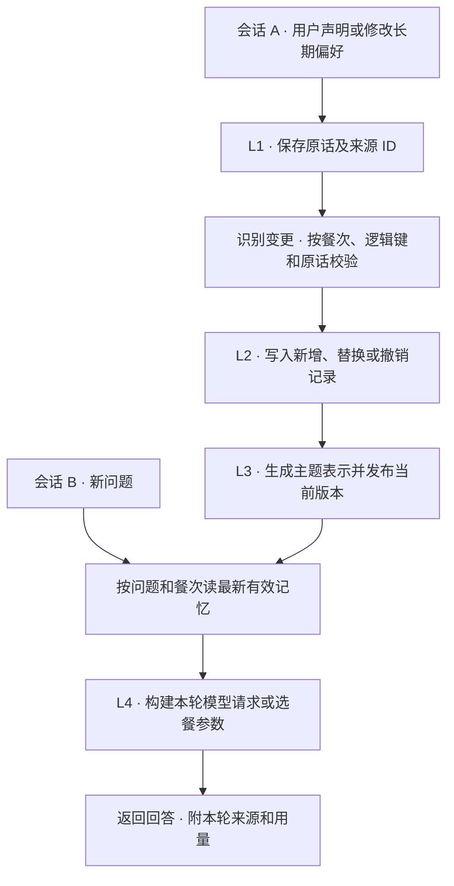

# Four-Layer Agent Memory Lab · 四层 Agent 记忆实验台

一个可在浏览器里操作的跨会话记忆 Demo。以热量选餐为例，四层记忆和 Deep Agents 都能从日常对话中提取长期偏好，在新会话中读回，并展示本轮使用的记忆、查询证据、耗时和 token。

四层设计借鉴 Anthropic 对原始记录、记忆笔记、记忆表示和注入上下文的划分。Deep Agents 分支接入 LangChain 的真实框架，使用自己的文件记忆和会话检查点。 [Anthropic 研究文章](https://www.anthropic.com/research/components-of-agent-memory) · [Deep Agents Memory](https://docs.langchain.com/oss/python/deepagents/memory)

## 快速启动

需要 Windows PowerShell、Python 3.11+ 和 Node.js 22+。首次克隆后，在项目根目录执行以下命令。安装脚本会创建虚拟环境、安装依赖、构建 React 前端，并在缺少 `.env` 时从模板复制一份。

```powershell
git clone https://github.com/19238daig/four-layer-agent-memory-lab.git
cd four-layer-agent-memory-lab
powershell -NoProfile -ExecutionPolicy Bypass -File .\scripts\setup.ps1
```

编辑根目录的 `.env`，填入自己的 OpenAI 兼容服务配置。模型需支持 JSON 输出，使用 Deep Agents 时还需支持工具调用。配置变更在重启服务后生效。

```dotenv
OPENAI_API_KEY=your-key
OPENAI_BASE_URL=https://your-openai-compatible-service/v1
OPENAI_MODEL=your-tool-capable-model
```

双击 **打开热量选餐.cmd**，或在服务运行后访问 [热量选餐实验室](http://127.0.0.1:8010/?view=meal)。可用 [健康检查](http://127.0.0.1:8010/api/health) 确认服务和模型名。启动失败时查看 `data/launcher.log`。服务默认监听本机 `127.0.0.1:8010`。

## Agent 框架



- **四层记忆**由项目编排提取、检索和上下文构造。选餐参数由对话和记忆解析，菜品与数值由 SQL 计算。
- **Deep Agents**使用 `create_deep_agent`、虚拟模式的 `FilesystemBackend` 和 JSON 检查点。框架可加载当前 `AGENTS.md`，调用 `read_memory_topic` 读取主题，并通过 `remember` 提交有原话依据的变更。项目校验后写入该分支的长期文件。
- **目录事实查询**与选餐推荐分开。“清汤牛肉面哪些店有卖”按菜品查门店，“KFC 出售的菜品有哪些”先解析门店称呼再查菜单。明确的目录查询可直接走共用只读查询路径，部分口语问法会先由模型生成结构化查询意图，再检查实体和操作。预算、热量和辣度用于推荐；门店别名可参与目录实体解析。两边对明确问题返回相同的数据库结果、且消耗为 0 token，是直接走共用查询路径的表现。
- **并排对话**把同一条消息交给两个引擎，后端按分支依次执行，分别记录来源、耗时和模型用量。两组长期记忆独立，所以只在单引擎中说过的偏好，另一分支可能尚未学到。

## 四层记忆与跨会话编排

| 层级 | 输入 | 输出 | 在哪里看到引用 |
| --- | --- | --- | --- |
| L1 · Transcripts 原始记录 | 用户消息、回答和执行记录 | 带会话、运行及消息 ID 的 JSONL 记录 | 来源里的用户原话，以及运行轨迹中的工具事件 |
| L2 · Memory notes 记忆笔记 | 原话与本轮提取的候选变更 | 有逻辑键、逐字引文和来源 ID 的 JSON 笔记 | 记忆变更项可回溯到原话，修改时可看到被替代的笔记 |
| L3 · Memory representations 记忆表示 | 当前有效笔记 | 按餐次与主题组织的 Markdown、索引和版本 JSON | `chat-index.md` 指向当前表示，表示引用笔记 ID |
| L4 · Injected context 注入上下文 | 新问题、同会话历史及匹配到的记忆 | 实际模型请求快照，或标注为未发送模型的选餐参数 | 展开回答的「查看记忆与来源 → 技术详情」 |



新会话默认读取同一工作空间内、对应引擎的当前记忆。历史聊天按会话隔离，长期偏好通过有效版本传递。本轮临时条件会覆盖本轮筛选。用户明确更新或撤销时，系统发布新版本并回读核对，旧版本保留给历史引用。例如，把晚饭「不超过 400 千卡」改为「超过 500 千卡」后，后续查询采用新的严格下限，旧上限退出当前筛选。

选择「新建无记忆对照」后，会话关闭长期记忆读写。无匹配偏好且问题也未给条件时，选餐使用界面标出的演示默认值。Deep Agents 的新会话有自己的 thread 和检查点，通过当前 `AGENTS.md` 继承长期记忆。「查看记忆与来源」中的 token 来自模型服务的用量字段，服务未返回时显示「未提供」。

## 浏览器演示

进入热量选餐实验室，选择 **并排对话**。下面的句子可直接粘贴到聊天框。

| 步骤 | 操作与输入 | 看什么 |
| --- | --- | --- |
| 1. 自动保存 | 发「以后晚饭我喜欢吃辣，预算500块，热量不超过1000千卡。」 | 两列的记忆状态与原话来源 |
| 2. 新会话读回 | 点「新会话」，发「晚上吃什么好？」 | 两列是否使用晚饭预算、辣度和热量上限。展开来源看实际查询与记忆版本 |
| 3. 修改再验证 | 发「以后晚饭热量要超过500千卡。」再新开会话，问同一句 | 本轮筛选是否显示严格下限，预算和口味是否仍按已保存偏好 |
| 4. 做无记忆对照 | 用「新会话」右侧的下拉菜单选「新建无记忆对照」，再问同一句 | 演示默认条件与已保存条件的差异，以及每列标注的记忆状态 |
| 5. 查数据库事实 | 发「清汤牛肉面哪些店有卖？」再问「S02店出售的菜品有哪些？」 | 前者按菜品查门店，后者按门店查菜单。结果及 SQL 证据可展开 |

每列回复底部可查看实际耗时与 token。「技术详情」保留本轮的上下文、工具与引用。用量和耗时用于观察这次运行，两条分支的提示词、工具和模型调用次数不同。

要逐层展示输入、输出和引用，请打开 [四层分步演示](http://127.0.0.1:8010/?view=studio)，按「录入 → 提取 → 整理 → 预览 → 提问」操作。完整九步见 [前端演示手册](docs/DEMO.md)。现场聊天和跨会话操作见 [聊天演示说明](docs/CHAT_V2.md)。

## 记忆文件与本地业务库

聊天侧栏的「记忆文件位置」显示当前工作空间目录。默认路径为 `data/memory_v2/meal/workspaces/meal-demo/`，其他空间用各自的目录名。

| 相对工作空间的路径 | 内容 |
| --- | --- |
| `four_layer/transcripts/`、`four_layer/notes/` | 原始对话 JSONL、原子笔记 JSON |
| `four_layer/knowledge/chat-index.md`、`four_layer/chat_versions/` | 当前主题入口与历次版本。首次保存长期记忆后生成入口 |
| `four_layer/contexts/` | 按运行保存的 L4 上下文和选餐参数 |
| `deep_agents/AGENTS.md`、`deep_agents/revisions/` | 当前长期记忆 Markdown 及其历史版本 |
| `deep_agents/knowledge/`、`deep_agents/chat_versions/` | 主题文件、结构化版本与来源 |
| `deep_agents/checkpoints/` | 按会话隔离的 JSON 状态及最新成功检查点 |
| `sessions/`、`runs/` | 会话设置、运行结果和执行事件 |

分步演示数据另存于 `data/memory_v2/studio/`，旧 SQLite 记忆文件用于只读迁移和归档。实际菜品业务库是 `data/meal_lab/meal_catalog.sqlite3`，由演示初始化。可在 DBeaver 选择 **SQLite** 驱动并打开该文件。仓库包含初始化代码和 SQL，`.env`、本地数据库和用户会话数据在 Git 忽略范围内。

热量查询先统一克数、可食率、生熟口径和份数，再按每 100 克的蛋白质、脂肪、碳水计算 `4P + 9F + 4C`，叠加吸油量区间；套餐对各组成项按数量求和。只有整个估算区间满足热量条件、且预算和辣度也符合时，才判为通过。关键字段缺失或区间只部分重叠会留下对应状态。计算细节见 [只读 SQL](sql/meal_lab/query.sql) 和 [选餐使用说明](docs/MEAL_LAB.md)。

## 代码入口与检查

| 路径 | 职责 |
| --- | --- |
| [frontend/src/ChatLab.tsx](frontend/src/ChatLab.tsx) | React 聊天、会话切换、进度及并排展示 |
| [backend/memory_demo/chat_api.py](backend/memory_demo/chat_api.py) | 会话与聊天接口、运行详情 |
| [backend/memory_demo/chat.py](backend/memory_demo/chat.py) | 对话编排、四层引擎、Deep Agents 适配与用量收集 |
| [backend/memory_demo/chat_memory.py](backend/memory_demo/chat_memory.py) | 记忆校验、版本变更和餐次检索 |
| [backend/memory_demo/file_store.py](backend/memory_demo/file_store.py)、[file_checkpoint.py](backend/memory_demo/file_checkpoint.py) | 文件持久化、检查点 |
| [backend/memory_demo/chat_catalog.py](backend/memory_demo/chat_catalog.py)、[catalog_language.py](backend/memory_demo/catalog_language.py) | 目录查询、口语语义计划和实体解析 |
| [sql/meal_lab/schema.sql](sql/meal_lab/schema.sql)、[query.sql](sql/meal_lab/query.sql) | 业务库结构及热量计算 |

```powershell
.\.venv\Scripts\python.exe -m pytest -q
npm run build --prefix frontend
npm run test:ui --prefix frontend
```

服务与模型配置就绪后，可用 `npm run test:chat --prefix frontend` 执行真实浏览器聊天验收。脚本使用本机 Edge，在独立工作空间运行并产生模型用量，结果写入 `artifacts/chat-v2/`。旧分步演示的实现与迁移前结构见 [架构说明](docs/ARCHITECTURE.md)。
