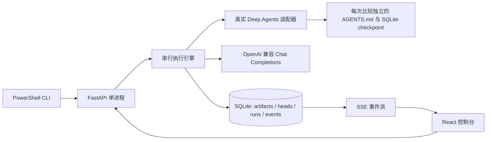

# 实现说明

V2 聊天和本地文件存储见 [聊天演示 V2](CHAT_V2.md)。下文保留原分步演示的处理链路。原图、旧路径和 SQLite 检查点描述用于说明迁移前结构。

## 组件与数据流

四层记忆与框架选择正交。当前四层方案使用小型自定义处理引擎，Deep Agents 作为真实对比分支。

## 四层对象

`artifacts` 保存不可变对象：

| 层级 | 类型 | 关键字段 |
|---|---|---|
| L1 | user_message / assistant_message | session、role、content、created_at |
| L2 | note | key、topic、importance、evidence、refs、version、supersedes |
| L3 | representation | topic、links、refs、version、supersedes |
| L4 | injection_seed | fact_refs、index_refs、字符数 |
| L4 | context_preview / injected_snapshot | session、refs、prepared_for_answer |
| L4 | model_context | 分区 sections、memory_chars、实际材料引用 |
| 回答 | answer | read_ids、cited_ids、invalid_citations、context_id |

`heads` 指向当前有效的逻辑键或主题。更新创建新对象，然后移动 head，不改写旧对象内容。历史引用始终指向原版本。

工具和模型执行原始事件存放在 `events`，通过运行 ID 与消息/记忆对象关联。每次比较的完整 Deep Agents 文件与 checkpoint 位于 `data/deepagents/<run-id>/`。

## 操作

- `record`：只追加用户消息，无模型调用。
- `distill`：对会话中未处理消息调用模型。校验来源 ID 与逐字 quote；同 key 生成新版本。成功后才标记消息已处理。
- `dream`：读取所有有效笔记和对应原文证据，生成主题 Wiki。校验每页引用、笔记覆盖和交叉链接；创建新的启动记忆。
- `context`：生成未发送的注入预览，无模型调用。
- `ask`：固定启动记忆快照；模型路由选择主题和搜索词；按需读取主题/笔记/原文；构造分区请求；保存回答与引用校验结果。
- `compare`：相同显式录入消息在独立空间重放，包含真实 Deep Agents 训练与新 thread 回答。
- `replay`：读取保存的事件并标明来源，不调用模型。

本 Demo 采用手动分步整理，便于演示每层边界。普通 `ask` 不自动 `distill` 或 `dream`；新消息先进入原文层。

## 注入与检索

L4 seed 主要包含 `response.*` 通用表达偏好和主题目录，限制1800字符。目录中的链接不是事实正文。每次 `ask` 留存独立快照。

检索路由只收到当前问题与主题标题，不预先获得整个用户档案。原文检索采用关键词和中文双字片段匹配；没有向量检索，规模定位于本地 Demo。

包含已失效笔记的主题页不会被当作当前有效主题使用，相关有效笔记可作为回退。用户完成 `dream` 后，新主题与启动目录会更新。生成回答时提示模型优先最新明确纠正，并保留原始消息时间。

当前会话历史仅选取同一 user、同一 session 的最近12条消息；跨会话不直接携带旧聊天全文，相关原文通过检索单独进入请求。

## 可观察性

- `read`：材料确实被检索返回。
- `in_context`：材料被构造到回答请求中；真正发起调用的记录是 `model_request`。
- `cited`：回答明确写出的 ID，且该 ID 存在于本次证据集合。

模型 token 统计取自服务返回值，缺失时显示“未提供”；字符数单独列示，不冒充 token。引用检查保证结构与已提供 ID 的一致性，不代替语义事实核验。

`dream` 可以用原文回查摘要，但当前没有自动的全库事实审计器或定时后台任务。主动用户纠正通过新笔记版本与重新整理生效。

## Deep Agents 分支

使用真实 `deepagents.create_deep_agent`、`ChatOpenAI`、`FilesystemBackend(virtual_mode=True)`、`memory=['/AGENTS.md']`、`SqliteSaver`。

文件根目录独立于工作区源码和 `.env`。学习时一条录入消息对应一个新 thread，下一条可读取上一条已写入的记忆；回答使用另一个新 thread。callback 保存真实模型请求、响应、token 和工具输入输出。文件更新后保存 before/after；若 agent 没有写入，页面会如实显示 unchanged。

每次对比重新创建空间；该次空间与 checkpoint 持久保留用于检查，不让下一次比较继承上一次的实验状态。

框架默认指令与工具会增加上下文，学习调用次数由实际 agent 行为决定。当前比较的模型调用、token、耗时包含学习与回答，不表示匹配计算预算的性能基准。

## 运行约束

FastAPI 仅监听回环地址，单 worker 串行执行记忆变更。任务状态与每个事件持久化。重新启动后，中断任务会被标记失败；不会把丢失工作线程的任务无限显示为运行中。

前端构建由 FastAPI 同源提供，SSE 支持 Last-Event-ID 重连。最近运行列表显示100条，按已知运行 ID 可查询更早记录。命令行默认等待完成，支持 `--no-wait`。
